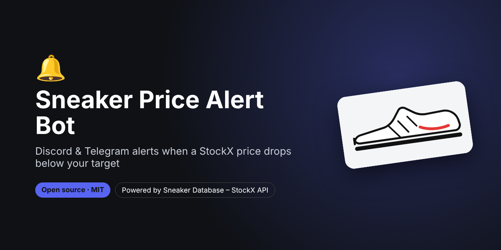
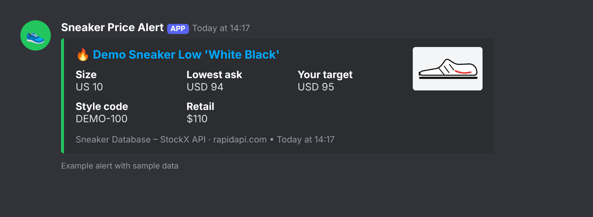
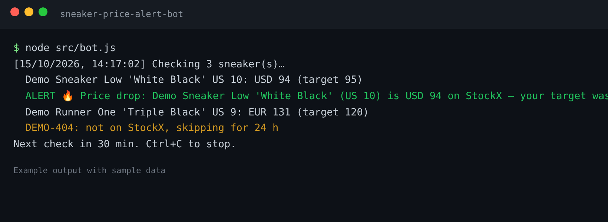

# Sneaker Price Alert Bot – StockX Price Drop Alerts on Discord & Telegram



> **For faster support reply, contact us on Telegram: [@pintoflow](https://t.me/pintoflow)**

Get a **Discord or Telegram notification when a sneaker's StockX price drops** to your target, **in your size and your currency**. Add the style codes you're watching to `watchlist.json` and the bot does the rest.

It runs on your computer, a server or **free on GitHub Actions**, with no server to manage. It's Node.js with **zero dependencies**.

Powered by the **[Sneaker Database – StockX API](https://rapidapi.com/belchiorarkad-FqvHs2EDOtP/api/sneaker-database-stockx)** on RapidAPI (free plan available).




<sub>Example alert and output with sample data.</sub>

---

## Features

- 🔔 **Price drop alerts** on **Discord** (webhook, rich embed) and/or **Telegram**
- 👟 Watch any sneaker by **style code / SKU** and **size**
- 🌍 Any **currency and country** (USD, EUR, GBP, CAD, AUD, JPY, CHF, KRW, SGD, HKD, MXN, NZD)
- 🧠 Smart alerting: one alert per price level, then **re-arms** when the price goes back up
- 🛟 Follows the API's best practices: resolves each SKU **once**, caches the `urlKey`, skips "not found" codes for 24 h, and backs off on errors
- ☁️ A **GitHub Actions** workflow is included, so it can run every hour for free

## Quick start

```bash
git clone https://github.com/BelNaruto/sneaker-price-alert-bot.git
cd sneaker-price-alert-bot
cp .env.example .env      # add your RAPIDAPI_KEY and DISCORD_WEBHOOK_URL
node src/bot.js           # runs forever, checks every 30 min
node src/bot.js --once    # one check (for cron)
```

1. Get an API key: **https://rapidapi.com/belchiorarkad-FqvHs2EDOtP/api/sneaker-database-stockx**
2. **Discord webhook:** Server Settings → Integrations → Webhooks → New Webhook → Copy URL
3. **Telegram (optional):** create a bot with [@BotFather](https://t.me/BotFather), then put the token and your chat ID in `.env`

## Watchlist

`watchlist.json`:

```json
[
  { "styleId": "DD1391-100", "size": "10", "targetPrice": 95, "currency": "USD", "country": "US" },
  { "styleId": "HP8739", "size": "9", "targetPrice": 120, "currency": "EUR", "country": "DE" }
]
```

| Field | Meaning |
|---|---|
| `styleId` | Style code / SKU. Dashes, spaces and case don't matter |
| `size` | US size, e.g. `10`, `9.5` |
| `targetPrice` | Alert when the lowest ask is at or below this |
| `currency` / `country` | Market to watch (defaults `USD` / `US`) |

## Run free on GitHub Actions

1. Fork this repo.
2. Go to **Settings → Secrets and variables → Actions** and add `RAPIDAPI_KEY` and `DISCORD_WEBHOOK_URL` (and/or `TELEGRAM_BOT_TOKEN`, `TELEGRAM_CHAT_ID`).
3. Edit `watchlist.json`.
4. Open the **Actions** tab, enable workflows and run **Sneaker price alert**. It then runs every hour and saves its state in `state.json`.

## How it works

```
watchlist.json ─► /stockx/product-by-style (once per SKU, cached in state.json)
                        │ urlKey
                        ▼
               /stockx/market-data?urlKey=…&currency=…&country=…
                        │ lowest ask for your size
                        ▼
          ask ≤ target? ──► Discord embed / Telegram message
```

| Endpoint | Used for |
|---|---|
| `GET /stockx/product-by-style` | Turns your style code into the StockX product (`urlKey`, title, image) |
| `GET /stockx/market-data` | Live lowest ask, highest bid and last sale for every size |

Prices are cached for 5 minutes on the API side, so the bot checks every 15 minutes at most (30 by default).

## Related projects

- 💰 [Sneaker Resell Profit Calculator](https://github.com/BelNaruto/sneaker-resell-profit-calculator): StockX vs GOAT vs Flight Club payout per size
- 📈 [Sneaker Market Dashboard](https://github.com/BelNaruto/sneaker-market-dashboard): trending sneakers, new releases and resale premiums
- 📘 [StockX Sneaker Price API docs and examples](https://github.com/BelNaruto/stockx-sneaker-price-api)

## Support

> **For faster support reply, contact us on Telegram: [@pintoflow](https://t.me/pintoflow)**

API: https://rapidapi.com/belchiorarkad-FqvHs2EDOtP/api/sneaker-database-stockx

---

MIT License. Not affiliated with, endorsed by or sponsored by StockX, Discord or Telegram.

**Keywords:** stockx price alert, sneaker price tracker, sneaker discord bot, stockx discord bot, sneaker price drop notification, telegram sneaker bot, stockx monitor, sneaker bot, resell alerts, stockx api
